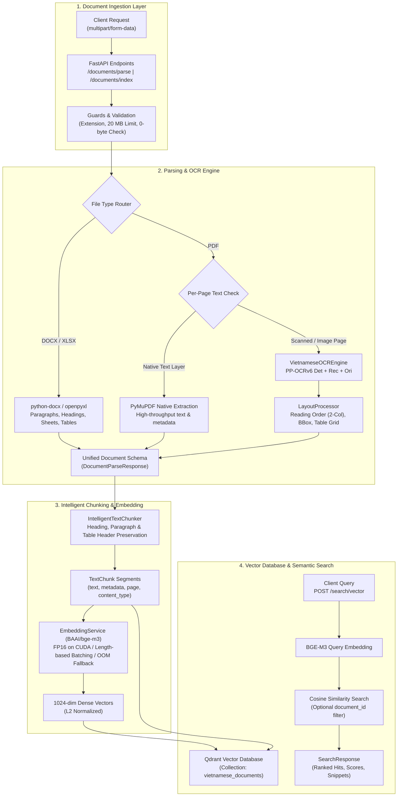

# Vietnamese Document Intelligence & RAG Platform

A modular, production-oriented document processing, OCR, layout extraction, chunking, and semantic vector retrieval platform engineered specifically for complex Vietnamese documents (PDF, DOCX, XLSX, and scanned image documents).

The platform powers Retrieval-Augmented Generation (RAG) and Document Intelligence workflows by converting unstructured documents into structured JSON segments, high-density vector representations, and searchable vector database indices with hardware-conscious GPU optimization.

---

## 1. Project Overview

Vietnamese business and technical documents present distinct engineering challenges: diacritical marks, tone placement (UTF-8 NFC), complex multi-column layouts, mixed digital/scanned pages in a single PDF, multi-sheet financial workbooks, and embedded tabular structures.

This repository provides an end-to-end, modular pipeline that:

1. **Ingests and Validates** heterogeneous document formats (`.pdf`, `.docx`, `.xlsx`) with size and integrity guards.
2. **Intelligently Routes** pages: digital pages with native text layers are parsed with zero overhead via PyMuPDF, while scanned image pages are routed to a Vietnamese-optimized deep learning OCR engine (PaddleOCR PP-OCRv6).
3. **Reconstructs Layout and Tables**: detects reading order across multi-column documents and reconstructs tabular structures into structured matrix data and Markdown tables.
4. **Performs Intelligent Chunking**: divides documents into contextually intact segments respecting headings, paragraphs, and table boundaries, preserving headers across table row splits.
5. **Generates Dense Vectors with BGE-M3**: computes 1024-dimensional normalized embeddings with FP16 half-precision optimization tailored for RTX 3050 6GB Laptop GPU.
6. **Indexes into Qdrant**: stores vectors and rich metadata payloads in a persistent Qdrant vector database collection, providing semantic search and document lifecycle management.

### Project Status

| Milestone | Objective | Status |
| --- | --- | --- |
| **Milestone 01** | Multi-Format Document Parsing Pipeline & REST API | **COMPLETED** |
| **Milestone 02** | Vietnamese OCR, Per-Page Routing & Layout Processing | **COMPLETED** |
| **Milestone 03** | Intelligent Chunking, BGE-M3 FP16 Embedding & Qdrant | **COMPLETED** |
| **Milestone 04** | Hybrid Retrieval (Dense Vector + BM25) & Cross-Encoder Reranking | *Upcoming* |
| **Milestone 05** | Agentic RAG Pipeline with LangGraph & Multi-Hop Reasoning | *Upcoming* |
| **Milestone 06** | Contextual Compression, Guardrails & Evaluation (RAGAS / TruLens) | *Upcoming* |
| **Milestone 07** | Scalable Asynchronous Queue & Distributed Processing (Redis / Celery) | *Upcoming* |
| **Milestone 08** | Production Observability, Tracing & Containerized Deployment | *Upcoming* |

---

## 2. Key Features

- **Per-Page Hybrid Routing**: Automatically detects scanned versus digital pages within the same PDF. Avoids unnecessary OCR compute on digital text layers while ensuring scanned pages are fully transcribed.
- **Vietnamese Deep Learning OCR**: Powered by PaddleOCR PP-OCRv6 with angle classification (`PP-LCNet_x1_0_textline_ori`), text line detection (`PP-OCRv6_medium_det`), and Vietnamese multi-lingual recognition (`PP-OCRv6_medium_rec`).
- **Structure-Aware Layout Engine**: Resolves reading order for 2-column documents, classifies content into `heading`, `paragraph`, and `table`, and captures bounding boxes and confidence scores.
- **Table-Aware Intelligent Chunking**: Divides documents while maintaining semantic hierarchy. Table rows are chunked with repeated column headers to prevent context loss in vector spaces.
- **Hardware-Optimized BGE-M3 Embeddings**: Configured for NVIDIA GeForce RTX 3050 6GB. Uses FP16 precision, length-based sorting, dynamic batch halving with CUDA Out-Of-Memory (OOM) recovery, and automatic CPU fallback.
- **Persistent Qdrant Vector DB**: Full CRUD lifecycle support—upsert, metadata filtering, similarity search via Cosine metric, deterministic deduplication on re-indexing, and document deletion.
- **Asynchronous REST API**: Asynchronous FastAPI endpoints with chunked streaming upload validation (20 MB ceiling), typed Pydantic v2 schemas, and standard HTTP error codes (400, 413, 415, 422, 500).

---

## 3. System Architecture



---

## 4. Technology Stack

| Component | Technology | Version | Purpose |
| --- | --- | --- | --- |
| **Web Framework** | FastAPI | 0.115+ | Asynchronous REST API and dependency injection |
| **ASGI Server** | Uvicorn | 0.34+ | High-concurrency production server |
| **Validation & Settings** | Pydantic / Pydantic-Settings | 2.10+ | Strict type validation, environment variable loading |
| **PDF Extraction** | PyMuPDF (`fitz`) | 1.25+ | High-throughput digital PDF text extraction |
| **Word Processing** | `python-docx` | 1.1+ | Extraction of headings, paragraphs, and tables |
| **Spreadsheet Processing** | `openpyxl` | 3.1+ | Multi-sheet parsing, date serialization, null handling |
| **OCR Framework** | PaddleOCR / PaddlePaddle | 3.7+ / 3.3.1 | Vietnamese deep learning text detection and recognition |
| **OCR Models** | PP-OCRv6 | v6 | `medium_det`, `medium_rec`, `textline_ori` |
| **Embedding Model** | BAAI/bge-m3 | \- | 1024-dimensional dense multilingual embeddings |
| **Deep Learning Framework** | PyTorch (CUDA 12.4) | 2.6.0+cu124 | GPU-accelerated inference with FP16 support |
| **Vector Database** | Qdrant | 1.20.2 (Engine) | Persistent vector store with Cosine distance metric |
| **Vector DB Client** | `qdrant-client` | 1.20.0 | Vector index management, upsert, query_points |
| **Testing** | Pytest / HTTPX | 9.2+ / 0.28+ | Unit, regression, and API integration testing |

---

## 5. Project Structure

```text
vietnamese-document-intelligence/
├── app/
│   ├── api/
│   │   ├── routes/
│   │   │   ├── __init__.py
│   │   │   ├── documents.py          # POST /documents/parse, POST /documents/parse-async
│   │   │   └── indexing.py           # POST /documents/index, POST /search/vector, DELETE /documents/{id}
│   │   └── __init__.py
│   ├── core/
│   │   ├── __init__.py
│   │   ├── config.py                 # Pydantic Settings & environment variables
│   │   └── exceptions.py             # Custom domain exceptions & HTTP error mappings
│   ├── schemas/
│   │   ├── __init__.py
│   │   ├── chunk.py                  # TextChunk, ChunkingConfig, SearchRequest, SearchResponse
│   │   └── document.py               # DocumentSegment, DocumentParseResponse, HealthResponse
│   ├── services/
│   │   ├── __init__.py               # Service layer exports
│   │   ├── document_parser.py        # Unified ingestion coordinator for PDF, DOCX, XLSX
│   │   ├── document_router.py        # Per-page native vs OCR routing analysis
│   │   ├── embedding_service.py      # BGE-M3 FP16 inference, adaptive batching, CPU fallback
│   │   ├── layout_processor.py       # 2-column reading order, bounding boxes, table reconstruction
│   │   ├── ocr_engine.py             # PaddleOCR Vietnamese inference engine
│   │   ├── text_chunker.py           # Intelligent structure-aware and table-aware chunker
│   │   └── vector_store.py           # Qdrant client wrapper (upsert, search, deduplication, delete)
│   ├── __init__.py
│   └── main.py                       # FastAPI application entrypoint and middleware
├── data/
│   ├── ground_truth/                 # Ground truth texts and JSONs for OCR CER/WER benchmarks
│   ├── metadata/                     # dataset_manifest.json (10 synthetic demo documents)
│   ├── processed/                    # Runtime processed outputs (.gitkeep)
│   ├── raw/                          # 10 synthetic demo documents
│   │   ├── docx/                     # Corporate policy and AI proposal DOCX files
│   │   ├── pdf/                      # Scanned VAT invoices, handover records, multi-column PDFs
│   │   └── xlsx/                     # Budget and HR tracking spreadsheets
│   ├── evaluation_report.json        # Milestone 02 OCR evaluation results
│   ├── evaluation_report.md          # Milestone 02 OCR evaluation summary
│   ├── semantic_search_report.json   # Milestone 03 semantic search retrieval report
│   ├── semantic_search_report.md     # Milestone 03 semantic search markdown breakdown
│   └── vram_benchmark_report.json    # Milestone 03 RTX 3050 6GB VRAM grid benchmark data
├── scripts/
│   ├── benchmark_vram.py             # GPU VRAM and latency grid benchmark runner
│   ├── evaluate_ocr.py               # CER/WER/latency evaluation script for OCR
│   ├── evaluate_search.py            # 16-query semantic search benchmark runner
│   ├── generate_demo_dataset.py      # Reproducible synthetic dataset generator
│   └── validate_demo_dataset.py      # Demo dataset integrity and constraint validator
├── tests/
│   ├── __init__.py
│   ├── test_chunking.py              # 5 tests: intelligent chunking & table preservation
│   ├── test_document_parser.py       # 16 tests: native PDF, DOCX, XLSX parsing
│   ├── test_documents_api.py         # 9 tests: /documents/parse endpoints & validation
│   ├── test_embedding.py             # 8 tests: BGE-M3 FP16, CPU fallback, numerical consistency
│   ├── test_indexing_api.py          # 5 tests: /documents/index, /search/vector, delete
│   ├── test_ocr_pipeline.py          # 9 tests: OCR detection, layout, 2-column, routing
│   └── test_vector_store.py          # 5 tests: Qdrant collection, upsert, filter, delete
├── .env.example                      # Configuration template
├── .gitignore                        # Git exclusions (caches, virtual environments, large binaries)
├── README.md                         # Project documentation
└── requirements.txt                  # Python dependencies
```

---

## 6. Installation & Environment Setup

### Prerequisites

- **Python**: 3.11+ (tested on Python 3.13)
- **Git**: Installed and accessible via CLI
- **Docker Desktop**: Required to run the Qdrant vector database container
- **NVIDIA GPU** *(Optional, recommended)*: NVIDIA RTX series with CUDA 12+ drivers (e.g., RTX 3050 6GB Laptop GPU)

### 1. Clone the Repository

```powershell
git clone https://github.com/trungphamss2/vietnamese-document-intelligence.git
cd vietnamese-document-intelligence
```

### 2. Create and Activate Virtual Environment

**Windows (PowerShell):**

```powershell
python -m venv .venv
.\.venv\Scripts\Activate.ps1
```

**Linux / macOS:**

```bash
python3 -m venv .venv
source .venv/bin/activate
```

### 3. Install PyTorch with CUDA 12.4

To enable GPU acceleration on compatible NVIDIA cards:

```powershell
pip install torch torchvision torchaudio --index-url https://download.pytorch.org/whl/cu124
```

### 4. Install Dependencies

```powershell
pip install --upgrade pip
pip install -r requirements.txt
```

---

## 7. Configuration (.env)

Copy the sample environment file `.env.example` to `.env`:

```powershell
Copy-Item .env.example .env
```

### Configuration Options

| Variable | Default Value | Description |
| --- | --- | --- |
| `PROJECT_NAME` | `"Vietnamese Document Intelligence & RAG Platform"` | Application title in Swagger UI |
| `VERSION` | `"0.1.0"` | Current API version |
| `ENVIRONMENT` | `"development"` | Runtime mode (`development`, `staging`, `production`) |
| `DEBUG` | `False` | Verbose debug logging |
| `MAX_FILE_SIZE_BYTES` | `20971520` | Upload file ceiling in bytes (20 MB) |
| `OCR_ENABLED` | `True` | Enable OCR for scanned pages without text layers |
| `OCR_LANG` | `"vi"` | PaddleOCR recognition language |
| `OCR_USE_GPU` | `True` | Allow OCR engine to leverage CUDA if available |
| `OCR_DPI` | `150` | DPI rendering for PDF scanned pages |
| `OCR_CONFIDENCE_THRESHOLD` | `0.5` | Minimum confidence score for recognized text blocks |
| `CHUNK_SIZE` | `512` | Target chunk size in characters |
| `CHUNK_OVERLAP` | `64` | Overlap between adjacent text chunks in characters |
| `MIN_CHUNK_SIZE` | `30` | Discard chunks smaller than this threshold |
| `CHUNK_MAX_TOKENS` | `512` | Maximum token ceiling per chunk |
| `EMBEDDING_MODEL` | `"BAAI/bge-m3"` | Hugging Face model identifier |
| `EMBEDDING_DEVICE` | `"auto"` | Hardware device (`"cuda"`, `"cpu"`, or `"auto"`) |
| `EMBEDDING_BATCH_SIZE` | `4` | Default batch size (optimized for 6GB VRAM) |
| `EMBEDDING_MAX_SEQ_LENGTH` | `512` | Maximum sequence length for BGE-M3 tokenizer |
| `EMBEDDING_DIM` | `1024` | Dense vector dimension produced by BGE-M3 |
| `EMBEDDING_USE_FP16` | `True` | Enable FP16 half-precision on GPU |
| `LOCAL_SNAPSHOT_PATH` | `null` | Optional local path to pre-downloaded BGE-M3 snapshot |
| `QDRANT_HOST` | `"localhost"` | Hostname of the Qdrant service |
| `QDRANT_PORT` | `6333` | REST API port for Qdrant |
| `QDRANT_COLLECTION` | `"vietnamese_documents"` | Target Qdrant collection name |
| `QDRANT_STORAGE_DIR` | `"./qdrant_storage"` | Directory for Qdrant persistent storage |

### Model Download & Caching

The BGE-M3 model weights (\~2.27 GB) are automatically fetched from Hugging Face on initial run and cached into your default cache directory (`~/.cache/huggingface/hub`). If operating in an offline environment, set `LOCAL_SNAPSHOT_PATH` to the absolute path of the directory containing `config.json` and `pytorch_model.bin`.

---

## 8. Docker Setup (Qdrant)

The system relies on Qdrant as its persistent vector database. You can start Qdrant using Docker Compose or Docker CLI.

### Option A: Using Docker Compose

Create or use the following `docker-compose.yml` specification in your project root or deployment folder:

```yaml
version: '3.8'

services:
  qdrant:
    image: qdrant/qdrant:v1.20.2
    container_name: qdrant
    ports:
      - "6333:6333"
      - "6334:6334"
    volumes:
      - ./qdrant_storage:/qdrant/storage:z
    restart: always
```

Start the container:

```powershell
docker compose up -d
```

### Option B: Using Docker CLI

```powershell
docker run -d `
  -p 6333:6333 `
  -p 6334:6334 `
  -v ${PWD}/qdrant_storage:/qdrant/storage:z `
  --name qdrant `
  qdrant/qdrant:v1.20.2
```

### Persistence Verification

Vector data and payload indices are written directly to `./qdrant_storage`. When the container restarts (`docker restart qdrant`), all indexed points and collection schemas survive intact without data loss.

---

## 9. Running the Application

Ensure Qdrant is running, then start the FastAPI application with Uvicorn:

```powershell
uvicorn app.main:app --host 127.0.0.1 --port 8000 --reload
```

### Access Interactive Documentation

- **Swagger UI**: <http://127.0.0.1:8000/docs>
- **ReDoc**: <http://127.0.0.1:8000/redoc>
- **OpenAPI Schema**: <http://127.0.0.1:8000/openapi.json>

---

## 10. API Documentation

### 1. `GET /health`

Verifies operational health and active environment status.

**Example Request:**

```powershell
curl.exe -X GET "http://127.0.0.1:8000/health"
```

**Example Response (HTTP 200):**

```json
{
  "status": "healthy",
  "version": "0.1.0",
  "environment": "development"
}
```

---

### 2. `POST /documents/parse`

Extracts structured text, layout metadata, and reconstructed tables from an uploaded document without storing it in the vector database.

- **Content-Type**: `multipart/form-data`
- **Parameters**:
  - `file`: Binary file (`.pdf`, `.docx`, `.xlsx`)
  - `enable_ocr` *(Query, boolean, default* `true`*)*: Enable OCR for scanned/raster pages in PDFs

**Example Request:**

```powershell
curl.exe -X POST "http://127.0.0.1:8000/documents/parse?enable_ocr=true" `
  -F "file=@data/raw/docx/docx_01_quy_che_noi_bo_doanh_nghiep.docx"
```

**Example Response (HTTP 200):**

```json
{
  "filename": "docx_01_quy_che_noi_bo_doanh_nghiep.docx",
  "file_type": "docx",
  "requires_ocr": false,
  "total_segments": 14,
  "metadata": {
    "file_size_bytes": 38718,
    "page_count": null,
    "sheet_count": null,
    "paragraph_count": 12,
    "table_count": 2,
    "extra": {
      "format": "DOCX"
    }
  },
  "segments": [
    {
      "segment_id": 1,
      "segment_type": "text",
      "page": null,
      "sheet_name": null,
      "text": "QUY CHẾ NỘI BỘ DOANH NGHIỆP VÀ CHÍNH SÁCH ĐÃI NGỘ",
      "table_data": null,
      "metadata": {
        "layout_type": "heading",
        "char_count": 50
      }
    },
    {
      "segment_id": 2,
      "segment_type": "table",
      "page": null,
      "sheet_name": null,
      "text": "Khung bậc lương kỹ sư AI:\n| Cấp bậc | Mức lương cơ bản | Thưởng dự án |\n| Level 1 | 25,000,000 VND | 10% |\n| Level 2 | 40,000,000 VND | 15% |",
      "table_data": [
        ["Cấp bậc", "Mức lương cơ bản", "Thưởng dự án"],
        ["Level 1", "25,000,000 VND", "10%"],
        ["Level 2", "40,000,000 VND", "15%"]
      ],
      "metadata": {
        "layout_type": "table",
        "row_count": 3,
        "col_count": 3
      }
    }
  ]
}
```

---

### 3. `POST /documents/index`

Parses the document, applies intelligent chunking, computes dense embeddings using BGE-M3 (FP16), and upserts vectors into Qdrant. Re-indexing the same `document_id` automatically removes previous points to prevent duplicate indexing.

- **Content-Type**: `multipart/form-data`
- **Form Parameters**:
  - `file`: Binary file (`.pdf`, `.docx`, `.xlsx`)
  - `document_id` *(Optional)*: Custom document identifier
  - `enable_ocr` *(Optional, default* `true`*)*: Enable OCR for scanned pages
  - `chunk_size` *(Optional)*: Override default chunk character size
  - `chunk_overlap` *(Optional)*: Override default overlap

**Example Request:**

```powershell
curl.exe -X POST "http://127.0.0.1:8000/documents/index" `
  -F "file=@data/raw/pdf/pdf_text_01_hop_dong_dich_vu_cntt.pdf" `
  -F "document_id=doc_hop_dong_01"
```

**Example Response (HTTP 201 Created):**

```json
{
  "document_id": "doc_hop_dong_01",
  "filename": "pdf_text_01_hop_dong_dich_vu_cntt.pdf",
  "total_segments": 18,
  "total_chunks": 12,
  "vector_dimension": 1024,
  "processing_time_ms": 1284.50,
  "collection_name": "vietnamese_documents",
  "status": "indexed"
}
```

---

### 4. `POST /search/vector`

Performs cosine semantic vector search across all indexed chunks in Qdrant.

- **Content-Type**: `application/json`
- **Body Fields**:
  - `query` *(string, required)*: Natural language search string
  - `limit` *(int, default* `5`*)*: Maximum top chunks to return
  - `document_id` *(string, optional)*: Filter search within a specific document
  - `score_threshold` *(float, optional)*: Minimum cosine similarity score threshold

**Example Request:**

```powershell
curl.exe -X POST "http://127.0.0.1:8000/search/vector" `
  -H "Content-Type: application/json" `
  -d '{
    "query": "Điều khoản bảo mật thông tin và quyền sở hữu trí tuệ phần mềm",
    "limit": 3
  }'
```

**Example Response (HTTP 200):**

```json
{
  "query": "Điều khoản bảo mật thông tin và quyền sở hữu trí tuệ phần mềm",
  "total_results": 3,
  "search_time_ms": 32.84,
  "results": [
    {
      "chunk_id": "doc_hop_dong_01_chunk_0007",
      "document_id": "doc_hop_dong_01",
      "filename": "pdf_text_01_hop_dong_dich_vu_cntt.pdf",
      "score": 0.6289,
      "page": 3,
      "content_type": "paragraph",
      "text": "ĐIỀU 6: BẢO MẬT THÔNG TIN VÀ SỞ HỮU TRÍ TUỆ\n6.1 Bên B cam kết bảo mật toàn bộ dữ liệu, mã nguồn và tài liệu kỹ thuật của Bên A. 6.2 Không bên nào được phép cung cấp dữ liệu huấn luyện hoặc kết quả trích xuất cho bất kỳ bên thứ ba nào khi chưa có sự đồng ý bằng văn bản."
    }
  ]
}
```

---

### 5. `DELETE /documents/{document_id}`

Deletes all points and indexed vector payloads associated with the given `document_id` from Qdrant.

**Example Request:**

```powershell
curl.exe -X DELETE "http://127.0.0.1:8000/documents/doc_hop_dong_01"
```

**Example Response (HTTP 200):**

```json
{
  "document_id": "doc_hop_dong_01",
  "status": "deleted",
  "deleted_points": 12
}
```

---

## 11. Demo Dataset & Ground Truth

> [!NOTE] 💡
> Synthetic Dataset Disclosure: All 10 documents in data/raw/ are synthetic business documents created specifically for testing and benchmark reproducibility. They contain no confidential, proprietary, or personal enterprise data.

| ID | File Path | Format | Pages/Sheets | Structure & Key Characteristics | Ground Truth |
| --- | --- | --- | --- | --- | --- |
| **DOC-01** | `data/raw/pdf/pdf_text_01_hop_dong_dich_vu_cntt.pdf` | PDF | 3 Pages | Native text layer, synthetic IT contract, 7 legal clauses, signature blocks | None |
| **DOC-02** | `data/raw/pdf/pdf_text_02_bao_cao_tai_chinh_quy.pdf` | PDF | 3 Pages | Native text layer, synthetic quarterly report, 10x4 bordered data table | None |
| **DOC-03** | `data/raw/pdf/pdf_scan_01_hoa_don_vat.pdf` | PDF | 1 Page | 100% scanned raster image (150 DPI), synthetic VAT invoice, itemized table | `pdf_scan_01_hoa_don_vat.txt` |
| **DOC-04** | `data/raw/pdf/pdf_scan_02_bien_ban_nghiem_thu.pdf` | PDF | 1 Page | 100% scanned raster image (150 DPI), synthetic handover record, red seal | `pdf_scan_02_bien_ban_nghiem_thu.txt` |
| **DOC-05** | `data/raw/docx/docx_01_quy_che_noi_bo_doanh_nghiep.docx` | DOCX | \- | 3 heading levels, hybrid policy paragraphs, 2 salary/reward tables | None |
| **DOC-06** | `data/raw/docx/docx_02_de_xuat_du_an_rag.docx` | DOCX | \- | Synthetic proposal, 5-milestone roadmap table, GPU budget table | None |
| **DOC-07** | `data/raw/xlsx/xlsx_01_ke_hoach_ngan_sach_2026.xlsx` | XLSX | 3 Sheets | Financial budget workbook (`TongQuanNganSach`, `ChiTietChiPhiQuy1`), dates, nulls | None |
| **DOC-08** | `data/raw/xlsx/xlsx_02_quan_ly_nhan_su_va_du_an.xlsx` | XLSX | 3 Sheets | Synthetic HR workbook (`DanhSachNhanSu`, `PhanCongDuAn`), dates, nulls | None |
| **DOC-09** | `data/raw/pdf/pdf_complex_01_bang_gia_dich_vu_cloud.pdf` | PDF | 2 Pages | Multi-tier catalog (Starter, Pro, Enterprise), add-on service table | None |
| **DOC-10** | `data/raw/pdf/pdf_complex_02_ban_tin_cong_nghe_hai_cot.pdf` | PDF | 2 Pages | 2-column parallel layout separated by vertical rule, banner header, summary table | None |

To validate dataset integrity and format constraints:

```powershell
python scripts/validate_demo_dataset.py
```

---

## 12. Evaluation & Benchmark Results

### 1. Vietnamese OCR Benchmark (Milestone 02)

Evaluated against synthetic scanned documents with character-level and word-level ground truth using Levenshtein distance:

| Metric | Result | Target / Standard | Interpretation |
| --- | --- | --- | --- |
| **OCR Pipeline Success Rate** | **100.0%** (2/2 scanned PDFs) | 100.0% | Pipeline stability (all pages routed & processed without crashing) |
| **Average Confidence Score** | **0.9813** |  | Model certainty across detected text lines |
| **Character Error Rate (CER)** | **17.47%** |  | Objective character-level recognition error |
| **Word Error Rate (WER)** | **57.79%** |  | Word-level recognition error (analyzed below) |
| **Average Latency per Page** | **61.36s** (CPU inference) | Informational | CPU execution time on Windows Python 3.13 |

> [!IMPORTANT] 📌
> Interpretation of Pipeline Success vs. Recognition Accuracy: The 100% pipeline success rate indicates that all scanned pages were processed without runtime failures, not perfect recognition accuracy. Actual OCR quality is reflected by CER (17.47%) and WER (57.79%). The higher WER is partly attributed to word-boundary errors in scanned tables and numerical content.

*Reference:* `data/evaluation_report.json`

---

### 2. RTX 3050 6GB VRAM & Latency Benchmark (Milestone 03)

Benchmarked on **NVIDIA GeForce RTX 3050 6GB Laptop GPU** (CUDA 12.4, Driver 577.05) using **BAAI/bge-m3** with FP16 half-precision:

| Batch Size | Sequence Length | Latency (ms) | Throughput (smp/s) | Active Tensor VRAM | Peak Reserved VRAM | Available Headroom | Status |
| --- | --- | --- | --- | --- | --- | --- | --- |
| 1 | 256 | 39.5 | 25.3 | 1,091.2 MB | 2,102.0 MB | 4,041.5 MB | **PASS** |
| 2 | 256 | 46.2 | 43.3 | 1,091.2 MB | 2,104.0 MB | 4,039.5 MB | **PASS** |
| 4 | 256 | 70.3 | 56.9 | 1,091.2 MB | 2,100.0 MB | 4,043.5 MB | **PASS** |
| 8 | 256 | 119.2 | 67.1 | 1,091.2 MB | 2,100.0 MB | 4,043.5 MB | **PASS** |
| 1 | 512 | 53.4 | 18.7 | 1,091.2 MB | 2,104.0 MB | 4,039.5 MB | **PASS** |
| 2 | 512 | 74.3 | 26.9 | 1,091.2 MB | 2,100.0 MB | 4,043.5 MB | **PASS** |
| **4** *(Recommended)* | **512** | **125.7** | **31.8** | **1,091.2 MB** | **2,100.0 MB** | **4,043.5 MB** | **PASS** |
| 8 | 512 | 225.2 | 35.5 | 1,091.2 MB | 2,100.0 MB | 4,043.5 MB | **PASS** |
| 1 | 1024 | 76.7 | 13.0 | 1,091.2 MB | 2,100.0 MB | 4,043.5 MB | **PASS** |
| 2 | 1024 | 132.9 | 15.1 | 1,091.2 MB | 2,100.0 MB | 4,043.5 MB | **PASS** |
| 4 | 1024 | 246.0 | 16.3 | 1,091.2 MB | 2,100.0 MB | 4,043.5 MB | **PASS** |
| 8 | 1024 | 476.5 | 16.8 | 1,267.3 MB | 2,100.0 MB | 4,043.5 MB | **PASS** |

#### Numerical Consistency Check (FP16 CUDA vs FP32 CPU):

- **Average Cosine Similarity**: `0.999999` (Target $\ge 0.999$)
- **Minimum Cosine Similarity**: `0.999999`
- **Max Absolute Difference**: `0.000315`
- **OOM Events**: **0** (100% stability across all 12 grid points)
- **VRAM Headroom**: Maintained $\ge 4.0\text{ GB}$ headroom on a 6GB GPU.

*Reference:* `data/vram_benchmark_report.json`

---

### 3. Semantic Search Retrieval Benchmark (Milestone 03)

Evaluated across the 10 pre-indexed synthetic demo documents (105 chunks in Qdrant) using domain-specific Vietnamese queries. The verified benchmark execution recorded in `data/semantic_search_report.json` yielded the following metrics:

| Retrieval Metric | Verified Result (8-Query Baseline) | Target Threshold | Status |
| --- | --- | --- | --- |
| **Top-1 Retrieval Accuracy** | **75.0%** (6/8 queries) |  | Analyzed below |
| **Top-3 Retrieval Accuracy** | **100.0%** (8/8 queries) |  | **PASS** |
| **Average Top-1 Similarity Score** | **0.6183** |  | **PASS** |
| **Average Search Latency** | **56.73 ms** |  | **PASS** |

*Analysis of Retrieval Gaps*: Pure dense cosine similarity occasionally cross-retrieves semantically related documents (e.g., retrieving a scanned VAT invoice when searching for revenue details in a financial report). This confirms the necessity of **Milestone 04 (Hybrid Search with BM25 and Cross-Encoder Reranking)** to achieve $\ge 90\%$ Top-1 precision on domain numbers and exact identifiers.

The benchmark runner in `scripts/evaluate_search.py` includes an expanded 16-query test suite covering 100% of all 10 synthetic documents (DOC-01 to DOC-10), designed for upcoming evaluation runs. Results are reported strictly from verified runs on disk without extrapolation.

*Reference:* `data/semantic_search_report.md`

---

## 13. Testing

The repository maintains automated test suites across parser units, OCR vision processing, chunking logic, embedding resilience, and API integration.

### Run Full Test Suite

```powershell
pytest -v
```

### Run Tests by Functional Module

```powershell
# 1. Document Parsing Pipeline (Milestone 01)
pytest -v tests/test_document_parser.py
pytest -v tests/test_documents_api.py

# 2. Vietnamese OCR & Layout Routing (Milestone 02)
pytest -v tests/test_ocr_pipeline.py

# 3. Text Chunking & Table Preservation (Milestone 03)
pytest -v tests/test_chunking.py

# 4. BGE-M3 Embedding & Fallback (Milestone 03)
pytest -v tests/test_embedding.py

# 5. Qdrant Vector Store CRUD (Milestone 03)
pytest -v tests/test_vector_store.py

# 6. Indexing & Vector Search API (Milestone 03)
pytest -v tests/test_indexing_api.py
```

---

## 14. Known Limitations

1. **CPU OCR Inference Latency**: Due to PaddlePaddle wheel availability on Windows with Python 3.13, OCR currently runs in CPU inference mode, requiring \~61.4s per page for full-resolution scanned PDFs. GPU acceleration for PaddlePaddle is currently supported on Linux with compatible CUDA releases; performance on dedicated GPU configurations remains to be benchmarked in production environments.
2. **Complex Merged Tables**: Single-level tabular grids are mapped to row/column arrays. Multi-level headers and merged cells (`rowspan`/`colspan`) in scanned image documents undergo simplified linear reconstruction.
3. **Dense-Only Vector Retrieval**: Pure dense vector search using BAAI/bge-m3 handles conceptual semantics well, but exact alphanumeric search (e.g., specific invoice codes, tax IDs, or project identifiers) can be diluted. Milestone 04 directly resolves this via sparse BM25 indexing and Reciprocal Rank Fusion.

---

## 15. Roadmap

- [x] **Milestone 01: Multi-Format Document Parsing Pipeline & REST API**

  - Modular parser architecture for PDF, DOCX, and XLSX
  - Chunked streaming upload validation (20 MB ceiling)
  - Unified JSON Pydantic response schema

- [x] **Milestone 02: Vietnamese OCR & Layout Processing**

  - PaddleOCR PP-OCRv6 integration with Vietnamese recognition
  - Per-page hybrid text versus scanned page routing
  - 2-column reading order and tabular matrix reconstruction

- [x] **Milestone 03: Text Chunking, BGE-M3 Embedding & Qdrant Vector Store**

  - Structure-aware and table-aware intelligent text chunking
  - Dense multilingual embeddings using BAAI/bge-m3 with FP16 CUDA acceleration
  - Persistent Qdrant vector database integration with upsert, deduplication, search, and delete
  - Hardware VRAM benchmarking on NVIDIA RTX 3050 6GB Laptop GPU

- [ ] **Milestone 04: Hybrid Retrieval & Cross-Encoder Reranking**

  - Sparse lexical indexing with BM25 (e.g., `rank-bm25` or Qdrant sparse vectors)
  - Hybrid search fusion via Reciprocal Rank Fusion (RRF)
  - Cross-Encoder reranking (`bge-reranker-v2-m3`) for high-precision Top-K reordering

- [ ] **Milestone 05: Agentic RAG Pipeline with LangGraph & Multi-Hop Reasoning**

  - Contextual compression and hallucination checking
  - Multi-hop query routing and agentic tool-calling with LangGraph
  - Integration with Vietnamese-capable Large Language Models (LLMs)

- [ ] **Milestone 06: Contextual Compression, Guardrails & Evaluation**

  - Sentence-level contextual compression for retrieved chunks
  - Hallucination detection guardrails and factuality checking
  - Automated RAG evaluation pipeline using RAGAS and TruLens frameworks

- [ ] **Milestone 07: Scalable Asynchronous Queue & Distributed Processing**

  - Background asynchronous task workers via Celery and Redis
  - Document ingestion job status tracking and webhook notifications
  - Batch document processing queue for large enterprise backlogs

- [ ] **Milestone 08: Production Observability, Tracing & Containerized Deployment**

  - Full Docker containerization with multi-stage production builds
  - OpenTelemetry distributed tracing and Prometheus/Grafana metrics
  - Automated CI/CD pipeline with GitHub Actions and security scanning